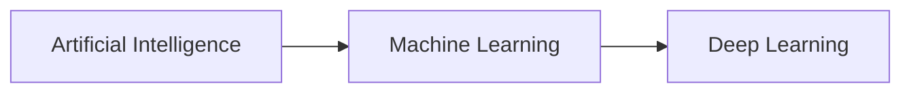
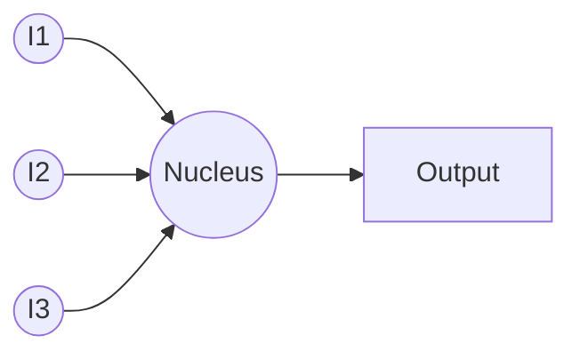
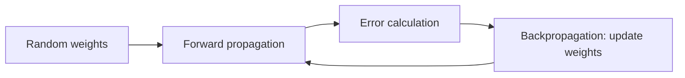
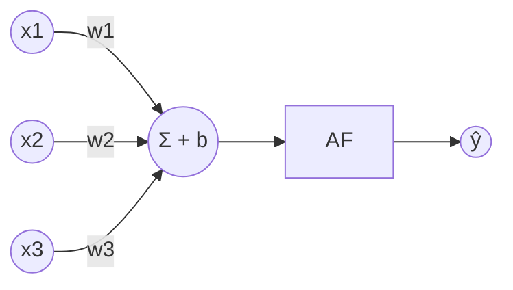
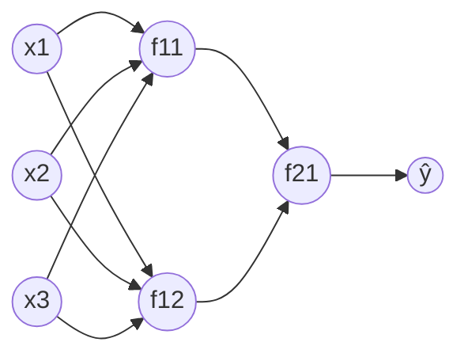

# Deep Learning Notes: From AI to ANN with Keras

Step-by-step notes on deep learning, taken from my handwritten class notes. They start with what AI is, build up through the perceptron, multilayer perceptron, the maths behind training, activation functions and weight initialization, and end with building an ANN in Keras.

## Contents

1. [What is AI?](#1-what-is-ai)
2. [Types of deep learning models](#2-types-of-deep-learning-models)
3. [Why deep learning?](#3-why-deep-learning)
4. [Inspiration: the perceptron](#4-inspiration-the-perceptron)
5. [Roadmap](#5-roadmap)
6. [The perceptron](#6-the-perceptron)
7. [Multilayer perceptron (MLP) and forward propagation](#7-multilayer-perceptron-mlp-and-forward-propagation)
8. [Basics of mathematics](#8-basics-of-mathematics)
9. [Backpropagation](#9-backpropagation)
10. [Activation functions](#10-activation-functions)
11. [Weight initialization techniques](#11-weight-initialization-techniques)
12. [Preparing data for a neural network](#12-preparing-data-for-a-neural-network)
13. [TensorFlow and Keras](#13-tensorflow-and-keras)
14. [Building an ANN with Keras](#14-building-an-ann-with-keras)
15. [Putting it together: ANN code](#15-putting-it-together-ann-code)

---

## 1. What is AI?

- AI means **mimicking human behaviour using a machine**.
- The idea is to create a robot whose behaviour is exactly similar to a human's in terms of understanding.

### AI is not automation

Task: go to the kitchen and prepare tea.

- **Automation:** build a bot with a fixed **set of rules**. If something changes (for example, the jars of sugar, tea powder and milk are moved around), the bot fails.
- **AI:** tries to solve the problem of **uncertainty** (things can change).

### AI, ML and DL



- ML algorithms (Linear Regression, Logistic Regression, SVM, Decision Tree, KNN, ...) solve the problem of uncertainty.
- **Deep learning** has neurons and is a **subset of ML**.

| | Works on |
|---|---|
| **ML** | Structured data (tabular) |
| **DL** | Both structured and unstructured data |

DL models can be:

- **Supervised:** labelled data, there is a target.
- **Unsupervised:** non-labelled data, there is no target.

---

## 2. Types of deep learning models

### Supervised DL models

**Computer Vision**

- Object detection
- Object classification
- Object tracking
- Image segmentation: classification based on pixels (e.g. a night vision camera works on pixel intensity)

**Natural Language Processing (NLP)**

Words carry feeling: context and sentiment matter.

- Text generation
- Summarization
- Classification
- Sentiment analysis
- Machine translation

### Unsupervised DL models

- **GAN:** generates synthetic data. It is like SMOTE, which creates synthetic numerical data, but a GAN creates synthetic data for images.
- **Autoencoders:** create hidden features from data.

---

## 3. Why deep learning?

- On a performance vs amount-of-data graph, **traditional (older) ML algorithms** flatten out, while **deep learning** keeps improving as data grows.

**Examples**

- **Facebook:** friend suggestion (face recognition) uses deep learning. Facebook reached an accuracy of 97.25%, while humans reach 97.6%, which is nearly equal.
- **Google data centre:** servers handle many requests per second and need a cooling machine. With the help of AI, the power consumption of the cooling system was reduced to 50% of the cooling cost, because DL can predict the connected load at a certain time. That 50% is about 15% of Google's total expenses.

**Remember**

- DL is computationally expensive, so for **small datasets traditional ML does a good job**.
- DL is the heart of AI.

---

## 4. Inspiration: the perceptron

- The first artificial neuron came in **1957** and was called the **perceptron**.
- Perceptron: a probabilistic model for information storage and organization in the brain.



- The inputs are summed: `I1 + I2 + I3 = Z1`.
- An **activation function (AF)** is applied to the sum: `AF(Z1)` gives the output.

---

## 5. Roadmap

1. What is a perceptron
2. Multilayer perceptron
3. Forward propagation
4. Activation function
5. Math (derivatives, chain rule of differentiation)
6. Backpropagation
7. Types of activation function
8. Weight initialization techniques
9. Optimizers
10. Batch normalization

*(Optimizers and batch normalization are not covered in these notes yet.)*

---

## 6. The perceptron

### Tea analogy

Task: prepare a good tea.

- Inputs: tea powder (w1), sugar (w2), milk (w3).
- The weighted inputs are added up (Σ), then pass through the **activation function**, which is like a **burner**: it activates the input (a catalyst).
- The output is the tea.
- **Error:** if the tea is not good (for example, not sweet enough), we go **back** and increase or decrease the weights, until we get a good taste.



> **1 iteration = forward propagation (FP) + error calculation + backpropagation (BP)**

At first, the weights are initialized **randomly**.

### The perceptron in maths



$$z = x_1 w_1 + x_2 w_2 + x_3 w_3 + b$$

$$\hat{y} = AF(z)$$

- The weights are randomly initialized.
- The **bias** is added to prevent the zero condition.
- `w1, w2, w3` give the amount of importance to each input.
- Error: the tea is not good.

### Weight updation rule (in general)

$$w_{new} = w_{old} - \eta \cdot \left[\text{rate of change of error w.r.t. change in weight}\right]$$

- `η` is the **learning rate**.
- The motto is to reduce the error `(y - ŷ)`, where `y` is the actual value and `ŷ` is the prediction.
- Goal: get the **optimum weights**.

### Disadvantage of a single neuron

`z = x1·w1 + x2·w2 + x3·w3 + b` has the same form as `y = mx + c`: the equation of a straight line (or a hyperplane for more inputs).

- In linear regression we fit a line (2D), plane (3D) or hyperplane (4D and above) so that the MSE is lowest.
- The problem: it **works well only if the data is linear**.
- In the real world, data is rarely linear.
- To overcome this, we use the **Multilayer Perceptron (MLP)**.

---

## 7. Multilayer perceptron (MLP) and forward propagation

Even though the activation function makes the output non-linear, **one neuron is not enough** to learn non-linear patterns in data perfectly. So we use many neurons in layers.

### Notation

**Weight** `w^k_mn`

- `k`: which layer it is going to
- `m`: which neuron it is going to
- `n`: which neuron it is coming from

**Neuron** `f_mn`

- `m`: which layer
- `n`: which neuron number in that layer

Example network: input layer L=0 (x1, x2, x3), hidden layer L=1 (f11, f12), output layer L=2 (f21).



- `f11`: 1st layer's 1st neuron
- `f12`: 1st layer's 2nd neuron
- `f21`: 2nd layer's 1st neuron

### Training a neuron

- Training means **adjusting the weights** so that the error is minimized.
- Differentiation gives the rate of change of a function with respect to a variable.
- Backpropagation carries all the gradient values (the error gradients).

### Forward propagation, step by step

**Step 1: at layer 1**

$$z^1_1 = x_1 w^1_{11} + x_2 w^1_{12} + x_3 w^1_{13} + b_1, \qquad a^1_1 = \sigma(z^1_1)$$

$$z^1_2 = x_1 w^1_{21} + x_2 w^1_{22} + x_3 w^1_{23} + b_2, \qquad a^1_2 = \sigma(z^1_2)$$

**Step 2: at the output layer (layer 2)**

$$z^2_1 = a^1_1 w^2_{11} + a^1_2 w^2_{12} + b_3, \qquad \hat{y} = \sigma(z^2_1)$$

**Step 3: error calculation**

`error = actual - prediction`

**Step 4: backpropagation and weight updation**

$$w_{new} = w_{old} - \eta \cdot \left[\text{rate of change of error w.r.t. change in weight}\right]$$

This rate of change is the **gradient**.

### GD vs SGD

The only difference is **how many training examples are used to update the parameters in each step**.

| | Gradient Descent (Batch GD) | Stochastic Gradient Descent (SGD) |
|---|---|---|
| Gradient calculated using | The **entire dataset**, then a single update | Just **one random training example**, then an update |

---

## 8. Basics of mathematics

### Chapter 1: Vectors

| | Definition | Examples |
|---|---|---|
| **Vector** | Quantity with magnitude **and** direction | Velocity, force, acceleration, weight |
| **Scalar** | Quantity with only magnitude | Speed, length/distance, mass, volume, time |

**Unit vector:** a vector with magnitude 1 and a direction.

- `î`: unit vector in the x direction
- `ĵ`: unit vector in the y direction
- `3î`: a vector with magnitude 3 in the x direction

**Example.** Point A (3, 2), so `OA = 3î + 2ĵ`.

- Magnitude: `|OA| = √(3² + 2²) = √(9 + 4) = √13`
- Unit vector in the direction of OA: `â = OA / |OA| = (3î + 2ĵ) / √13 = (3/√13) î + (2/√13) ĵ`

**Two vectors are the same when**

- both have equal magnitude, and
- both have the same direction.

**Distance between two vectors.** A (1, 5) and B (3, 7):

- `OA = 1î + 5ĵ`, `OB = 3î + 7ĵ`
- `AB = final - source = OB - OA = 2î + 2ĵ`
- The distance is the magnitude of AB: `√(2² + 2²) = √8 = 2√2`

### Chapter 2: Differentiation

Differentiation measures the **rate of change of a variable with respect to a change in another variable**.

- A function: `y = f(x)`. The value of `y` depends on the value of `x`.
- Every function depends on its variables and can be shown as a graph, for example `y = x`, `y = x²`, `y = sin x`.

$$\frac{dy}{dx} = \lim_{\Delta x \to 0} \frac{\Delta y}{\Delta x} = \frac{\text{change in } y}{\text{small change in } x}$$

**Example:** `y = x² + 2`

- At `x0 = 1`: `y0 = 1 + 2 = 3`
- At `x1 = 1.00001`: `Δx = 1.00001 - 1 = 0.00001`, `y1 = (1.00001)² + 2`, `Δy = y1 - y0`

**Definition.** Differentiation is the process of finding the **derivative** of a function. It measures how the dependent variable changes when its independent variable changes (the instantaneous rate of change, or the slope of a curve at a specific point).

$$f'(x) = \lim_{h \to 0} \frac{f(x+h) - f(x)}{h}$$

**Geometric meaning**

- `dy/dx = Δy/Δx = tan θ`, the slope of the **tangent line**.
- Right triangle: `tan θ = p/b`, `sin θ = p/h`, `cos θ = b/h` (p = perpendicular, b = base, h = hypotenuse).
- For any function, the rate of change of the function with respect to its independent variable at a point is the **tangent value** at that point.

So `dy/dx` = **gradient** = **tangent**. In `w_new = w_old - η [rate of change of error w.r.t. change in weight]`, that bracket is the rate of change of the function (error) with respect to its variable (weight).

### Common formulas

| Function | Derivative |
|---|---|
| `y = x²` | `dy/dx = 2x` |
| `y = xⁿ` | `dy/dx = n·x^(n-1)` |
| `y = eˣ` | `dy/dx = eˣ` |
| `y = constant` (e.g. 5) | `dy/dx = 0` |
| `y = x² + x³` | `dy/dx = 2x + 3x²` |

**Product rule**

`y = u·v` gives `dy/dx = u·(dv/dx) + v·(du/dx)`, that is, (1st × d of 2nd) + (2nd × d of 1st).

Example: `y = (x + 1)(x²)`

```
dy/dx = (x + 1)·d(x²)/dx + x²·d(x + 1)/dx
      = (x + 1)·2x + x²·(1 + 0)
      = 2x² + 2x + x²
      = 3x² + 2x
```

**Quotient rule**

`y = u/v` gives `dy/dx = (v·du/dx - u·dv/dx) / v²`, for example `y = (x + 1) / x²`.

### Partial derivatives

When a function has two or more variables, for example `y = f(x, z) = x² + z²`, its graph is a surface (not a curve).

- `∂y/∂x`: rate of change of the function with respect to `x`, assuming the other variables stay **constant** (z = constant).
- `∂y/∂z`: rate of change with respect to `z`, with x constant.

For `z = f(x, y)`:

- `∂z/∂x` = change in z / small change in x, **keeping y constant**
- `∂z/∂y` = change in z / small change in y, **keeping x constant**

**Example:** `z = x² + y²`

- `∂z/∂x = 2x + 0 = 2x`
- `∂z/∂y = 0 + 2y = 2y`

### Maxima and minima

A curve can have a **local maxima**, **local minima**, **global maxima** and **global minima**.

- At a point of minima or maxima, the **gradient is 0**: `dy/dx = 0`.
- The tangent there is horizontal: `θ = 0°`, so `tan θ = 0`.

---

## 9. Backpropagation

- Backpropagation means **travelling back into the network**.
- It is required to **update the bias and weights**.

Network: input layer L=0 (x1, x2, x3) → hidden layer L=1 → output layer L=2 → `ŷ` → loss.

### Loss function

- The error is a **function of all the weights** in the system. This is called the **loss function**: `Loss = f(w)`, based on (actual - predicted).
- Mean Squared Error:

$$MSE = \frac{1}{n} \sum (y - \hat{y})^2$$

- Since the loss is a function of many variables, the gradient for a weight such as `w¹₁₁` is a **partial derivative**: `∂L/∂w¹₁₁`.

### Weight update

$$w^1_{11,\,new} = w^1_{11,\,old} - \eta \left[\frac{\partial L}{\partial w^1_{11}}\right]$$

This is the SGD update: `w_new = w_old - η [∂L/∂w]`.

### Chain rule of differentiation

The gradient of the weight `w¹₁₁` is found by the chain rule:

$$\frac{\partial L}{\partial w^1_{11}} = \frac{\partial L}{\partial O_2} \times \frac{\partial O_2}{\partial O_1} \times \frac{\partial O_1}{\partial w^1_{11}}$$

Here `∂O₂/∂O₁` is the derivative of the activation function (for example, the sigmoid function).

### Learning rate (η)

- `η` is kept as small as possible (between 0 and 1, e.g. 0.01, 0.001).
- **Very low:** convergence is very slow.
- **Very high:** tries to reach the minima faster, but may **miss the minima** (the loss jumps around and can't reach it).

### Convergence

- For a convex loss, the loss goes down step by step towards the global minima.
- At the global minima `∂L/∂w = 0`, so `w_new = w_old - η × 0 = w_old`.
- When the weights stop updating, the system assumes the **global minima of the loss is reached**. This is **convergence**.

---

## 10. Activation functions

### 1. Sigmoid

$$\sigma(x) = \frac{1}{1 + e^{-x}}$$

- Output ranges between **0 and 1**.
- **Drawback:** the maximum value of its derivative `σ'(x)` is **0.25**.
- In a deep network the chain rule multiplies many such derivatives:

  `∂L/∂w₁ = ∂L/∂O₉ × ∂O₉/∂O₈ × ∂O₈/∂O₇ × ... = 0.25 × 0.25 × 0.25 × ...` = a tiny number (≈ 0.0000064)

- Then `w_new = w_old - η × (tiny number) ≈ w_old`. The weight update does not happen. This is the **vanishing gradient problem** (the gradient itself vanishes).
- So don't use it as a hidden-layer activation. Use it **only in the output layer for binary classification**.

### 2. tanh (hyperbolic tangent)

$$\tanh(x) = \frac{e^x - e^{-x}}{e^x + e^{-x}}$$

- Output ranges from **-1 to 1**.
- Better than sigmoid, but in a large network it still causes the vanishing gradient problem.
- The maximum value of its derivative is 1, but you won't get 1 every time. A chain like 0.4 × 0.3 × 0.2 × 0.5 × 0.6 still becomes very small.
- So don't use it as an activation function in hidden layers.

### 3. ReLU (Rectified Linear Unit)

$$f(x) = \max(0, x)$$

- Used in **all the hidden layers**.
- When the input is negative, the output is 0. When the input is positive, the output is the same as the input.
- The gradient (tangent) in the negative region is zero.
- **Disadvantage: dead neuron.** If a neuron's input is negative, its derivative is 0. Because of the chain rule the whole product becomes zero, so `∂L/∂w = 0` and there is **no weight updation**.

### 4. Leaky ReLU

Solves the dead neuron condition.

$$f(x) = \max(0.1x, x)$$

- `0.1x` is used for negative inputs, `x` for positive inputs.
- The rate of change of a straight line is constant, so the gradient never becomes zero.

### 5. Exponential Linear Unit (ELU)

- `f(x) = x` when the input is positive.
- `f(x) = a(eˣ - 1)` when the input is negative.
- A smooth curve.

### 6. Softmax

- Used in **multiclass classification**.
- Applied only in the **output layer**.
- Calculates the **probability** of each output.
- For 3-class classification the output layer has **3 neurons**. For binary classification it needs only **1 neuron**.

**Example.** Nine inputs go to three output neurons:

| Neuron | Calculation | Sum |
|---|---|---|
| 1 (cat) | 1×0.1 + 2×0.2 + 3×0.3 | 1.4 |
| 2 (dog) | 4×0.5 + 5×0.6 + 6×0.4 | 7.4 |
| 3 (lion) | 7×0.4 + 8×0.8 + 9×0.9 | 17.3 |

$$\text{Softmax}(z_i) = \frac{e^{z_i}}{e^{1.4} + e^{7.4} + e^{17.3}}$$

Probabilities: cat ≈ 0, dog ≈ 0, lion ≈ 0.99 (almost 1). Out of all the probabilities, the **maximum** is the final output (lion).

### 7. Linear activation function

- No activation at all (the identity function).
- Used **only in the output layer for regression problems**.
- The output layer requires **1 neuron**.

### Summary: which one to use where

| Activation | Use | Note |
|---|---|---|
| Sigmoid | Output layer, binary classification | Vanishing gradient in hidden layers |
| tanh | Avoid in hidden layers | Vanishing gradient in large networks |
| ReLU | All hidden layers | Dead neuron problem |
| Leaky ReLU | Hidden layers | Fixes dead neurons |
| ELU | Hidden layers | Smooth curve |
| Softmax | Output layer, multiclass classification | One neuron per class |
| Linear | Output layer, regression | 1 neuron |

---

## 11. Weight initialization techniques

- **Xavier / Glorot initialization**
- **He initialization** (named after the scientist Kaiming He)

**Xavier Normal**

`w ~ N(0, Var(w))`, with mean 0 and `Var(w) = 2 / (n_in + n_out)`

**Xavier Uniform**

`w ~ U(-√(6 / (n_in + n_out)), +√(6 / (n_in + n_out)))`

**He Normal**

`w ~ N(0, Var(w))`, with `Var(w) = 2 / n_in`

**He Uniform**

`w ~ U(-√(6 / n_in), +√(6 / n_in))`

**Example.** A neuron with 3 inputs and 2 outputs, using Xavier Normal:

- `Var(w) = 2 / (3 + 2) = 2/5`
- All the weights come from a normal distribution with **mean = 0** and **variance = 2/5**.

**Which one to use**

- For **ReLU**, use He Normal or He Uniform.
- For **other** activations, use Xavier Normal or Xavier Uniform.

---

## 12. Preparing data for a neural network

For the practical, the data (`Churn.csv`) sits in Google Drive and is mounted in **Google Colab**.

### Encoding categorical columns (one-hot / dummies)

```
fruits    apple  ball  cucumber
apple       1      0      0
ball        0      1      0
apple       1      0      0
cucumber    0      0      1
```

```python
Geography = pd.get_dummies(data.Geography, drop_first=True)
Gender = pd.get_dummies(data.Gender, drop_first=True)
data = pd.concat([data, Geography, Gender], axis=1)
```

- `drop_first=True` drops the first dummy column. One column is redundant (it can be worked out from the others), and dropping it keeps the number of columns down. Too many columns leads to the **curse of dimensionality**.

### Split and scale

1. Separate `X` and `y`.
2. Train-test split: `X_train.shape = (7500, 11)`, `X_test.shape = (2500, 11)`.
3. **Scaling (important):**

```python
X_train = sc.fit_transform(X_train)
X_test = sc.transform(X_test)
```

| Scaling **not** required | Scaling **required** |
|---|---|
| Decision Tree, Random Forest, XGBoost | Linear Regression, Logistic Regression, KNN, K-Means, SVM (distance-based algorithms), and neural networks |

**Why scale?** A neuron is `w1x1 + w2x2 + w3x3 + b`, like linear regression. Without scaling, a feature/column with large values makes the model biased towards that column.

**fit vs fit_transform**

- `fit`: learns from the data (μ, σ).
- `fit_transform`: learns (μ, σ) and then transforms: `x_scaled = (x - μ) / σ`.
- Use `fit_transform` on the training data and only `transform` on the test data.

**StandardScaler:** the result has **μ = 0 and σ = 1** (the Z-score).

---

## 13. TensorFlow and Keras

- **TensorFlow:** a framework to deal with deep learning. It is a Google product with too much low-level tweaking.
- **Theano:** came before TensorFlow. Very low level and too complicated.
- **Keras:** created by the scientist **François Chollet** as a **wrapper** around Theano, to make things simpler.
- TensorFlow then used Keras as its wrapper, and Google hired François.

```python
from tensorflow import keras   # Keras inside TensorFlow
import keras                   # standalone Keras
```

Keras is a refined, high-level version for working with TensorFlow.

---

## 14. Building an ANN with Keras

### MLP for binary classification

- **Input neurons = number of features (columns)**
- Then hidden layers (HL), then 1 output neuron for binary classification.

### Model types

| Model | Idea |
|---|---|
| **Sequential** | Layers stacked one after another |
| **Functional** | Layers can connect in more complex ways (branches) |

### Layers

- **Dense:** a fully connected layer of neurons.
- **Dropout(0.3):** deactivates 30% of the neurons (randomly, during training). A neural network is prone to **overfitting**, and dropout helps reduce it.

### Creating the model

```python
from tensorflow.keras.models import Sequential
from tensorflow.keras.layers import Dense, Dropout

model = Sequential()
model.add(Dense(units=11, input_dim=11, activation="relu", kernel_initializer="he_uniform"))
model.add(Dense(units=16, activation="relu", kernel_initializer="he_uniform"))
model.add(Dense(units=8, activation="relu", kernel_initializer="he_uniform"))
model.add(Dense(units=1, activation="sigmoid", kernel_initializer="glorot_uniform"))

model.summary()
```

- `units`: how many neurons are in that layer.
- `kernel_initializer`: the **weight initialization** (He for ReLU, Glorot/Xavier for the sigmoid output).
- The output layer has 1 neuron with **sigmoid** (binary classification).

**Counting parameters** for the first layer (11 inputs, 11 neurons):

`11 × 11 = 121` weights + `11` biases = **132**

### Compile the model

```python
model.compile(loss="binary_crossentropy", optimizer="adam", metrics=["accuracy"])
```

Choosing the loss (see the Keras documentation for more):

| Loss | Problem type |
|---|---|
| `mse` | Regression |
| `binary_crossentropy` | Classification (binary) |
| `categorical_crossentropy` or `sparse_categorical_crossentropy` | Classification (multiclass) |

### Fit the model

```python
model_history = model.fit(X_train, y_train, epochs=15, validation_split=0.33, batch_size=10)
```

- **Epoch:** the complete data goes through the network once.
- **validation_split = 0.33:** 33% of the data is kept as validation data, and is used to evaluate the performance at every epoch.
- **Batch size:** how many records go into the network at a particular time.

**Batch size example.** 10 records with batch size = 2: 2 records go to the network at a time, so it takes **5 iterations** to complete 1 epoch.

**Our data.** `X_train.shape = (7500, 11)`, `epochs = 15`, `batch_size = 10`.

- At one iteration 10 data points go in.
- Without a validation split: 7500 / 10 = 750 iterations per epoch.
- With `validation_split = 0.33`: 7500 × 0.67 ≈ 5025 records are used for training, so 5025 / 10 ≈ **503 iterations per epoch** (`Epoch 1/15: 503/503`).

### Overfitting and stopping at the right epoch

- On the accuracy vs epoch graph, there comes a point where **train accuracy keeps increasing but validation (test) accuracy stops increasing**. That is **overfitting**: good performance on train, bad on test.
- In the example the best point is at **epoch 3**. Retrain the whole model with only **3 epochs**.
- The same thing can be checked for the **loss**.

---

## 15. Putting it together: ANN code

The steps from the notes in one place. The churn data has 10 input columns; after one-hot encoding Geography (2 columns) and Gender (1 column) there are 11 features.

```python
import pandas as pd
from sklearn.model_selection import train_test_split
from sklearn.preprocessing import StandardScaler
from tensorflow.keras.models import Sequential
from tensorflow.keras.layers import Dense, Dropout

# in Colab: mount Google Drive first, then read the csv from there
data = pd.read_csv("Churn.csv")

# one-hot encode the text columns, dropping the first dummy column
Geography = pd.get_dummies(data.Geography, drop_first=True)
Gender = pd.get_dummies(data.Gender, drop_first=True)
data = pd.concat([data, Geography, Gender], axis=1)

# separate X and y
X = data.drop(columns=["RowNumber", "CustomerId", "Surname", "Geography", "Gender", "Exited"])
y = data["Exited"]

# train-test split: 7500 train rows, 2500 test rows
X_train, X_test, y_train, y_test = train_test_split(X, y, test_size=0.25, random_state=0)

# scaling: fit on train only, then just transform the test data
sc = StandardScaler()
X_train = sc.fit_transform(X_train)
X_test = sc.transform(X_test)

# build the network
model = Sequential()
model.add(Dense(units=11, input_dim=11, activation="relu", kernel_initializer="he_uniform"))
model.add(Dense(units=16, activation="relu", kernel_initializer="he_uniform"))
# model.add(Dropout(0.3))   # optional, helps with overfitting
model.add(Dense(units=8, activation="relu", kernel_initializer="he_uniform"))
model.add(Dense(units=1, activation="sigmoid", kernel_initializer="glorot_uniform"))
model.summary()

# compile and train
model.compile(loss="binary_crossentropy", optimizer="adam", metrics=["accuracy"])
model_history = model.fit(X_train, y_train, epochs=15, validation_split=0.33, batch_size=10)

# check where validation accuracy stops improving, then retrain with fewer epochs
print(model_history.history["accuracy"])
print(model_history.history["val_accuracy"])
```

---

*Still to add: optimizers and batch normalization.*
