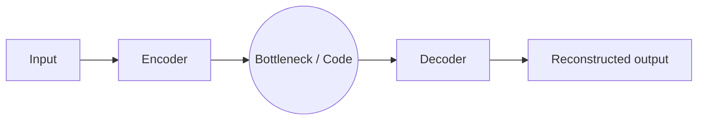
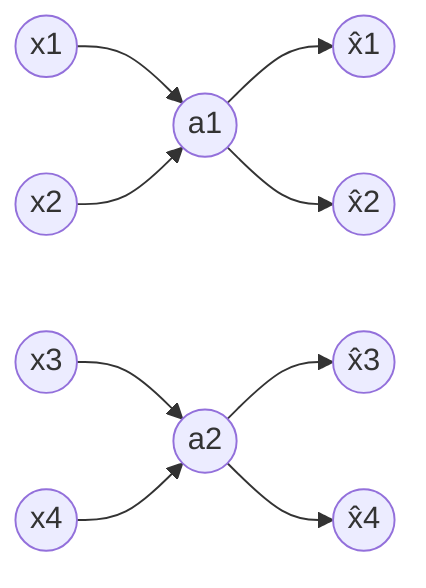
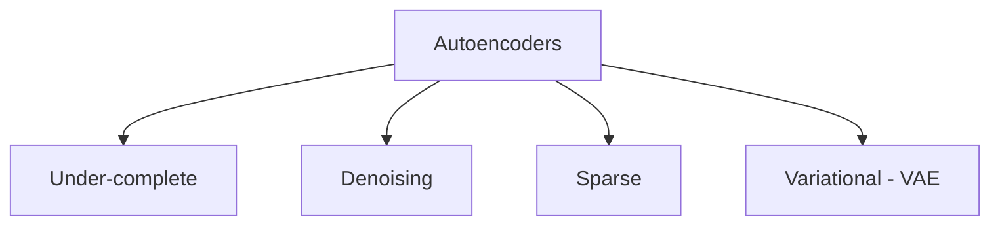
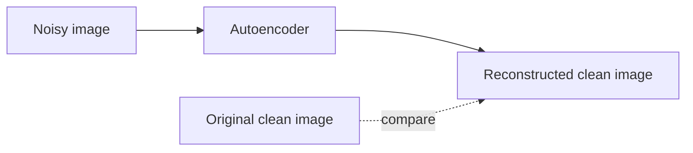
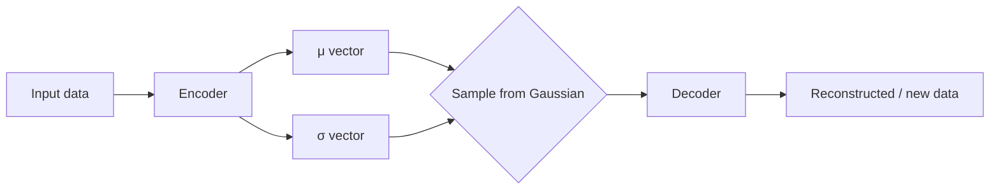

# Autoencoders: Study Notes

My notes on autoencoders, covering how they work, the main types, and how to train them. Everything here comes from my handwritten notes, tidied up and put in one place.

## Contents

1. [What is an autoencoder?](#what-is-an-autoencoder)
2. [Structure and components](#structure-and-components)
3. [Types of autoencoders](#types-of-autoencoders)
4. [Variational autoencoders (VAE)](#variational-autoencoders-vae)
5. [Training autoencoders](#training-autoencoders)
6. [Quick Keras example](#quick-keras-example)
7. [Summary table](#summary-table)

---

## What is an autoencoder?

An autoencoder is a neural network that learns to copy its input to its output, but it has to do it through a narrow middle layer. That forces it to learn a compact version of the data.

- It is **unsupervised learning**. There are no labels, and the input is also the target.
- It has two parts: an **encoder** and a **decoder**.
- The encoder turns the input into a reduced-dimensional representation, often called the **latent space** or **encoding**.
- The decoder rebuilds the original input from that representation.
- The usual architecture is encoder, bottleneck layer, decoder.



**In one line:**
- Encoder: higher-dimensional data goes to lower dimensions.
- Decoder: lower-dimensional data goes back to higher dimensions.

---

## Structure and components

### Encoder

- The input layer takes the raw data.
- The hidden layers shrink the dimensionality step by step, picking up the important features and patterns. Together these layers make up the encoder.
- The last hidden layer is the **bottleneck (latent space)**, where the dimensionality is reduced the most. It holds the compressed encoding of the input.

### Bottleneck

- Also called the **code**. It is the most compressed form of the input.
- It is the output layer of the encoder and the input layer of the decoder.
- The main goal when designing and training an autoencoder is to find the **smallest number of features (dimensions)** that still lets the network rebuild the input well.
- The latent space representation (the code) comes from this layer and is passed on to the decoder.

### Decoder

- It takes the encoded representation from the bottleneck and expands it back to the original input size.
- The hidden layers increase the dimensionality step by step while trying to reconstruct the original input.
- The output layer gives the reconstruction, which should be as close to the input as possible.



*Input layer, then a smaller hidden layer (the bottleneck), then an output layer the same size as the input.*

---

## Types of autoencoders



### 1. Under-complete autoencoder

- Learns a compressed representation of the input.
- Does dimensionality reduction by forcing the network to keep only the most important features.
- Used for feature learning, anomaly detection and denoising.

**Why the bottleneck must be small:** if the bottleneck holds all the features instead of only the essential ones, the autoencoder overfits. The decoder can simply copy input to output (an identity function) and memorise the training data without learning anything useful.

### 2. Denoising autoencoder

- The input is a noisy or partly corrupted image (for example, with Gaussian noise added).
- The network is trained to rebuild the **original, clean image** from the corrupted input.
- The reconstruction loss compares the denoised output with the clean original.
- It learns to pull out the important features and ignore the noise and useless features.



### 3. Sparse autoencoder

- A **regularized** autoencoder, used to make sure the network does not just learn the identity function (overfitting).
- Learns a sparse representation and keeps only a few hidden neurons active at a time.
- Uses regularization, such as an **L1 penalty** (L2 or a sparsity constraint can also be used), which pushes weights towards 0.
- Encourages feature extraction and is common in dimensionality reduction tasks.

### 4. Variational autoencoder (VAE)

Covered in detail in the next section.

### Related: convolutional encoder-decoder

For images, the encoder and decoder can be built from convolutional layers. An RGB image goes in and the output can be another image, such as a segmentation map.

---

## Variational autoencoders (VAE)

- A **generative model**. It can create new data points from just a little bit of noise as input.
- It learns a compressed representation of the training data as a **probability distribution**, then uses it to generate new samples by creating variations.
- It learns **continuous latent variables**.

### Regular autoencoder vs VAE

| | Autoencoder (AE) | Variational autoencoder (VAE) |
|---|---|---|
| Encodes the input as | A single fixed vector, e.g. `(2, 3)` | A `μ` (mean) vector and a `σ` (spread) vector |
| Latent space | Discrete (specific values) | Continuous (a range of values, e.g. `(2.2, 3.3)`) |
| Encoding | Fixed | Stochastic (random sampling) |
| Generative? | No | Yes |

### How it works

1. The encoder maps the input to a latent distribution. It outputs `μ` and `σ`, which are the parameters of a Gaussian distribution.
2. A latent vector is **randomly sampled** from that distribution.
3. The decoder generates data from the sampled latent variables.



- A VAE balances **reconstruction accuracy** with **latent space continuity**. (In practice the loss is the reconstruction loss plus a KL divergence term.)
- **Interpolation:** you can create a new data point that lies between existing ones.
- **Random sampling:** sampling from the distribution gives new variations.
- These two together are what give a VAE its generative power.

---

## Training autoencoders

### Design choices

| Hyperparameter | What it does |
|---|---|
| **Code size** | Number of nodes in the middle layer. A smaller size means more compression. |
| **Number of layers** | Sets how complex the model is. |
| **Nodes per layer** | Decreases with each layer of the encoder and increases again in the decoder. |

### Loss function (reconstruction loss)

| Data | Loss |
|---|---|
| Continuous data / input values outside `[0, 1]` | **MSE** (mean squared error) |
| Binary data / input values in `[0, 1]` | **BCE** (binary cross-entropy) |

The reconstruction loss measures the gap between the output and the input. It is used to update the model weights with **gradient descent** during **backpropagation**.

### Ways to stop the network from just copying the input

1. **Keep the hidden layers small.** This forces the network to keep only the representative features.
2. **Regularization.** Add a loss term to the cost function.
3. **Denoising.** Add noise to the input and teach the network to remove it.
4. **Tune the activation function.** Change the activations so most nodes stay dormant (not active) most of the time, which effectively shrinks the hidden layer.

---

## Quick Keras example

A small under-complete autoencoder on MNIST. The pixels are scaled to `[0, 1]`, so binary cross-entropy is a good loss.

```python
from tensorflow import keras
from tensorflow.keras import layers

# load MNIST and flatten the images, pixel values scaled to 0-1
(x_train, _), (x_test, _) = keras.datasets.mnist.load_data()
x_train = x_train.reshape(-1, 784).astype("float32") / 255
x_test = x_test.reshape(-1, 784).astype("float32") / 255

# encoder -> bottleneck -> decoder
inputs = keras.Input(shape=(784,))
x = layers.Dense(128, activation="relu")(inputs)
code = layers.Dense(32, activation="relu")(x)        # bottleneck
x = layers.Dense(128, activation="relu")(code)
outputs = layers.Dense(784, activation="sigmoid")(x)

autoencoder = keras.Model(inputs, outputs)
autoencoder.compile(optimizer="adam", loss="binary_crossentropy")

# the input is also the target
autoencoder.fit(x_train, x_train,
                epochs=20,
                batch_size=256,
                validation_data=(x_test, x_test))
```

**Denoising version:** add noise to the input but keep the clean images as the target.

```python
import numpy as np

x_train_noisy = np.clip(x_train + 0.3 * np.random.normal(size=x_train.shape), 0, 1)
x_test_noisy = np.clip(x_test + 0.3 * np.random.normal(size=x_test.shape), 0, 1)

autoencoder.fit(x_train_noisy, x_train,
                epochs=20,
                batch_size=256,
                validation_data=(x_test_noisy, x_test))
```

---

## Summary table

| Type | Main idea | Typical use |
|---|---|---|
| Under-complete | Small bottleneck forces compression | Feature learning, anomaly detection, dimensionality reduction |
| Denoising | Rebuild the clean input from a corrupted one | Removing noise from images |
| Sparse | Few active neurons, using an L1 penalty | Feature extraction, dimensionality reduction |
| Variational (VAE) | Learn a probability distribution and sample from it | Generating new data, interpolation |
